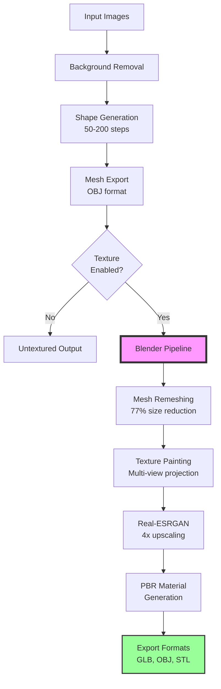

# ComfyUI AI GameDev Nodes

Custom ComfyUI nodes for AI-powered game asset generation, focusing on 3D model creation from images and videos.

## Features

### 🎮 Implemented Nodes

#### 1. **Hunyuan3D 2.1** - Image to 3D Generation
- Generate high-quality textured 3D models from single or multiple images
- **Complete pipeline with intelligent processing**:
  1. **Background Removal** - Automatic segmentation for clean inputs
  2. **3D Shape Generation** - Neural FlowMatching diffusion (50-200 steps)
  3. **Mesh Remeshing** - Optimized topology (77% size reduction)
  4. **Real-ESRGAN Upscaling** - 4x texture enhancement
  5. **PBR Texture Painting** - Multi-view consistent textures via Blender
  6. **Multi-format Export** - GLB (with textures), OBJ, STL outputs
- **Smart memory management**: 
  - Shape only: 10GB VRAM (untextured OBJ)
  - With texture: 21GB VRAM (full pipeline with Blender)
- Support for 1-10 input images for multi-view reconstruction
- Outputs textured/remeshed versions for optimal game engine performance

#### 2. **Frame Extractor** - Smart Video Frame Extraction  
- Extract evenly-distributed frames from videos
- Skip intro/outro frames automatically
- Perfect for turntable videos → 3D reconstruction
- Memory-efficient batch processing

### 🚀 Planned Nodes
- **Prompt Optimizer** - Model-specific prompt enhancement
- **Text-to-Video** - Game animation generation
- **Image-to-Video**: Animate static game assets

### 🎯 Frame Selector
- Extract evenly distributed frames from videos
- Perfect for multi-view 3D reconstruction
- Configurable frame distribution strategies

### 💬 Prompt Optimizer
- Enhance prompts for specific AI models (Flux, WANVideo, etc.)
- Model-specific vocabulary optimization
- Automatic prompt extension and refinement

### 🗣️ Text-to-Speech
- Generate character voices and narration
- Multiple voice styles and languages

## Installation

### Via ComfyUI Manager
1. Open ComfyUI Manager
2. Search for "AI GameDev"
3. Click Install
4. **Important**: After installation, run the setup script:
   ```bash
   cd ComfyUI/custom_nodes/comfyui-ai-gamedev
   python install.py
   ```

### Manual Installation
```bash
# Navigate to your ComfyUI custom_nodes directory
cd ~/path/to/ComfyUI/custom_nodes/  # Replace with your ComfyUI location
git clone --recursive https://github.com/mattwilliamson/comfyui-ai-gamedev.git
cd comfyui-ai-gamedev

# Run the installation script
python install.py

# Or manually:
git submodule update --init --recursive
pip install -r requirements.txt
pip install -r external/Hunyuan3D-2.1/requirements.txt
```

### Post-Installation Setup

1. **Install Blender** (Required for texture painting):
   ```bash
   # Ubuntu/Debian:
   sudo apt install libssl-dev ca-certificates -y  # SSL/TLS libraries
   sudo snap install blender --classic              # Install via snap
   # Or: sudo apt install blender                   # Install via apt
   
   # Verify installation:
   blender --version
   ```
   Other systems: [Download Blender](https://www.blender.org/download/)

2. **Download Model Weights**: Follow instructions in `external/Hunyuan3D-2.1/README.md`

3. **Optional - Conda Environment** (Recommended for isolation): 
   ```bash
   conda create -n hunyuan3d python=3.10
   conda activate hunyuan3d
   python install.py --skip-conda
   ```

## Directory Structure

```
comfyui-ai-gamedev/
├── nodes/                    # Custom node implementations
│   ├── hunyuan3d/           # Hunyuan3D 2.1 nodes
│   ├── frame_selector/      # Frame selection nodes
│   └── prompt_optimizer/    # Prompt enhancement nodes
├── examples/                 # Example files and samples
│   ├── input_images/        # Sample input images
│   │   ├── single_view/    # Single reference images
│   │   └── multi_view/     # Multiple view sets
│   └── output_samples/      # Generated samples
├── workflows/               # Example ComfyUI workflows
│   └── reference/          # Reference implementations
├── resources/              # Model weights and configs
└── docs/                   # Documentation
```

## Hunyuan3D 2.1 Workflow

The Hunyuan3D 2.1 node performs an intelligent multi-stage pipeline:



### Key Processing Steps:

1. **Background Removal**: Automatic segmentation removes backgrounds from input images
2. **Shape Generation**: Neural diffusion model creates base 3D geometry (10GB VRAM)
3. **Mesh Remeshing**: Optimizes topology for game engines (6.5MB → 1.5MB)
4. **Texture Painting**: Projects multi-view textures onto UV-mapped mesh
5. **Real-ESRGAN Upscaling**: Enhances texture resolution by 4x
6. **PBR Materials**: Generates base color, metallic, and roughness maps
7. **Multi-Format Export**: Outputs optimized GLB (with textures), OBJ, and STL

## Usage Examples

### Basic Image-to-3D
1. Load an image using ComfyUI's Image Loader
2. Connect to Hunyuan3D 2.1 node
3. Configure:
   - **Resolution**: 256/512/1024 (shape quality)
   - **Texture Resolution**: 512/1024/2048 (texture detail)
   - **Shape Steps**: 50-200 (generation quality)
   - **Texture Steps**: 50-100 (painting iterations)
4. Enable texture painting (requires Blender)
5. Run workflow → Receive optimized 3D model with PBR textures!

### Multi-View 3D Reconstruction
1. Load 4-10 views of your object
2. Connect batch to Hunyuan3D 2.1 node
3. Node automatically detects multi-view mode
4. Higher quality geometry from multiple references
5. Consistent texturing across all views
6. Export remeshed GLB for Unity, Unreal, or Godot

### Video to 3D Pipeline
1. Load video with Frame Extractor
2. Extract 5-10 evenly distributed frames
3. Skip intro/outro frames automatically
4. Pass frames to Hunyuan3D for reconstruction
5. Get game-ready 3D asset from video turntable

## Example Input Images

The repository includes sample images for testing:

### Included Examples
- **Single View**: `examples/input_images/single_view/railgun/frame_001_4x.png`
  - High-resolution railgun model for single-view 3D generation
  
- **Multi-View Set**: `examples/input_images/multi_view/frame_*_4x.png`
  - 10 frames showing a railgun from different angles (frames 001-081)
  - Perfect for testing multi-view 3D reconstruction
  - Demonstrates how video frames can be used for better 3D generation

### Adding Your Own Images
- **Single View Images**: Place in `examples/input_images/single_view/`
- **Multi-View Sets**: Place in `examples/input_images/multi_view/`
  - Best results with 4-10 views from different angles
  - Evenly distributed viewing angles work best

## Workflow References

Included reference workflows in `workflows/reference/`:
- `default_3d_hunyuan3d_image_to_model.json` - Example Hunyuan3D 2.0 workflow
- `default_3d_hunyuan3d_image_to_model_API.json` - API version for automation

These demonstrate the current Hunyuan3D 2.0 pipeline which our 2.1 nodes enhance with texture support.

## Requirements

- ComfyUI (latest version)
- Python 3.10
- PyTorch 2.5.1+ with CUDA 12.4
- Blender (for texture painting in Hunyuan3D)
- CUDA-capable GPU with 21GB+ VRAM for texture generation (or CPU mode)
- SSL certificates (installed via conda)

## Performance & Optimization

### Processing Times (RTX 4090):
- **Shape Generation**: 2-3 minutes (single view), 4-5 minutes (multi-view)
- **Texture Painting**: 3-5 minutes (Blender pipeline)
- **Total Pipeline**: 5-8 minutes for complete textured model

### Optimization Tips:
- **Resolution Settings**: 
  - Prototyping: 256 shape, 512 texture
  - Production: 512+ shape, 1024+ texture
- **Memory Management**:
  - Shape only: 10GB VRAM
  - Full pipeline: 21GB VRAM
- **File Size Reduction**:
  - Original mesh: ~6.5MB
  - After remeshing: ~1.5MB (77% reduction)
  - Maintains visual quality with optimized topology
- **Multi-View Benefits**:
  - 4+ views: Significantly better geometry
  - 6-10 views: Optimal quality/time balance
  - Consistent texturing across all angles

## Contributing

Contributions are welcome! Please read our contributing guidelines and submit pull requests to the main repository.

## License

This project is licensed under the MIT License. Individual model weights may have their own licenses.

## Acknowledgments

- Tencent Hunyuan team for Hunyuan3D 2.1
- ComfyUI community
- All AI model creators whose work powers these nodes

## Support

For issues, questions, or feature requests, please open an issue on [GitHub](https://github.com/mattwilliamson/comfyui-ai-gamedev/issues).
